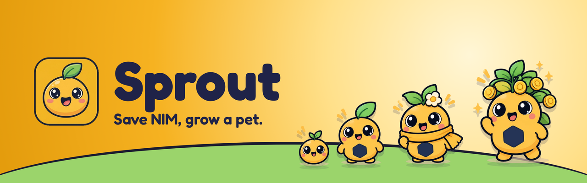
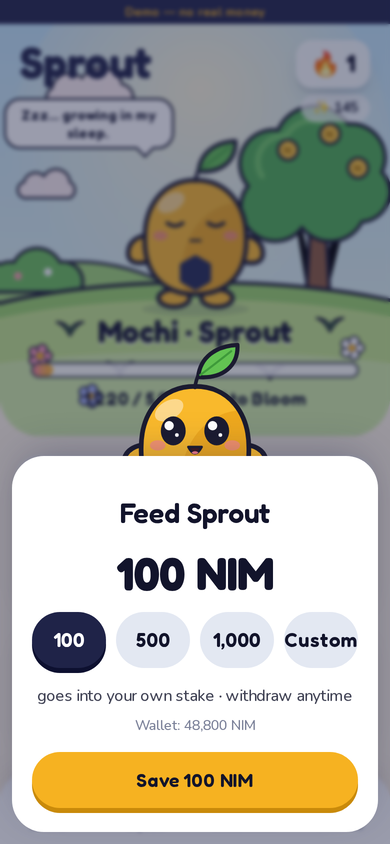
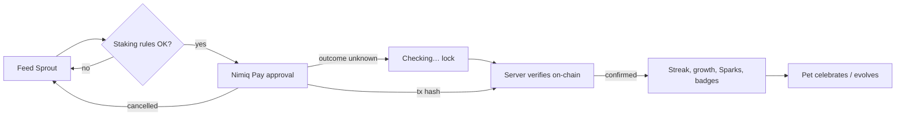

<p align="center">
  
</p>

<h3 align="center">Saving is a habit problem, not a math problem. Sprout gives the habit a face.</h3>

<p align="center">
  <a href="https://youtu.be/zP_6x3hiYb8"></a>
  <a href="https://sprout-three-neon.vercel.app"></a>
  <a href="https://sprout-three-neon.vercel.app/demo"></a>
  <a href="https://sprout-testnet.vercel.app"></a>
</p>
<p align="center">
  <a href="https://github.com/LSUDOKO/Sprout/actions/workflows/ci.yml"></a>
  
  
  
  
</p>

---

**Sprout** is a [Nimiq Pay](https://nimiq.com) Mini App where saving money feels like raising a pet.
Every NIM you save is a staking transaction from **your own wallet into your own NIM stake**: your money
never leaves your address, it earns staking rewards while you sleep, and Sprout grows with it. Keep a weekly
streak, evolve Sprout from **Seed → Sprout → Bloom → Grove**, and save together with friends in **Squads**.

## 🎬 Demo video

<p align="center">
  <a href="https://youtu.be/zP_6x3hiYb8">
    
  </a>
</p>

## 🔗 Links

| | |
|---|---|
| **App (mainnet, real NIM)** | https://sprout-three-neon.vercel.app — open in **Nimiq Pay → Mini Apps → Custom URL** |
| **Testnet (free test NIM)** | https://sprout-testnet.vercel.app — switch Nimiq Pay to testnet first |
| **Demo (any browser, no wallet)** | https://sprout-three-neon.vercel.app/demo |
| **Public proof of verified saves** | https://sprout-three-neon.vercel.app/proof |
| **Video** | https://youtu.be/zP_6x3hiYb8 |

## 📱 Screens

<p align="center">
  
  
  
  
</p>
<p align="center">
  
  
  
  
</p>

## 🌱 How it works

1. **Open Sprout in Nimiq Pay** and tap **Connect**. You sign a one-time message (no transaction, no fee); the
   server verifies the Ed25519 signature and derives your address.
2. **Name your pet.** It starts as a tiny **Seed**.
3. **Plant your seed (100 NIM).** Pick a staking pool (a neutral recommendation: active, compounding, highest
   trust score, lowest fee) and approve the **new-staker** transaction in Nimiq Pay.
4. **Sprout verifies it on-chain.** The save counts only when the transaction is executed, from your address,
   to the staking contract, with the exact amount. Then your pet celebrates.
5. **Feed weekly.** Each save adds to your own stake (`sendStakeTransaction`). Reach your weekly goal to keep
   your **streak**; total stake + kept weeks **evolve** your pet.
6. **Grow overnight.** Staking rewards compound into your stake. Sprout shows *proven* earnings
   (stake + withdrawn − deposited) and greets you with "While you slept, Sprout grew +X NIM".
7. **Save with friends.** Create a **Squad**, share the invite link/QR, keep a squad streak, and send
   **treats** (NIM payments with a `sprout:t:<squad>` memo, verified on-chain). Friends can **plant** a treat
   into their own stake.
8. **Withdraw anytime, honestly.** Stop earning → wait out the chain's cooldown → unlock → send to wallet.
   Money is never "locked".



## 🏆 How Sprout meets the judging criteria

| Criterion | What Sprout does | Where to look |
|---|---|---|
| **Functionality & reliability** | Every flow works end to end; a save counts only after on-chain verification; unknown outcomes can never be paid twice; chain lag never loses a save | `src/lib/server/verify.ts`, `src/lib/client/txFlow.ts` |
| **Error handling** | Cancel, unsupported, invalid, network/unknown outcome, not-in-Nimiq-Pay, wrong network, stale chain data — each has its own honest message and rule (table below) | `src/lib/nimiq/wallet.ts` |
| **Nimiq integration** | `sign()` sign-in, 5 staking transaction types, memo payments, `getHostNetwork`, host language, server-side JSON-RPC verification, Validators API pools | see table below |
| **Real need & audience** | Young adults building a weekly saving habit; non-custodial, so trust is never a question | onboarding copy |
| **Originality** | A pet that grows from **real, proven staking rewards** + **squad streaks** — nothing else in Save does this | |
| **Repeat value** | Weekly streak, overnight growth, evolutions, squads, treats, badges, cosmetic shop | |
| **Design & UX** | Original character and art, animated SVG pet (4 stages × 7 moods), 360px-first, reduced-motion support, EN / हिन्दी / ES | `src/components/pet/` |
| **Real usage** | Public proof page lists every verified real save with an explorer link | `/proof` |
| **Open source** | MIT, CI on every push, 85 unit/integration + 21 E2E tests | `.github/workflows/ci.yml` |

### Nimiq integration

| Nimiq feature | Used for |
|---|---|
| `sign(message)` | Sign-in and linking extra accounts — verified on the server (Ed25519 over the Nimiq signed-message format), cross-checked against `@nimiq/core` |
| `sendNewStakerTransaction` | First save (plant, ≥ 100 NIM, chosen pool) |
| `sendStakeTransaction` | Weekly saves and planting treats |
| `sendSetActiveStakeTransaction` | Withdraw step 1 — stop earning |
| `sendRetireStakeTransaction` | Withdraw step 2 — unlock after cooldown |
| `sendRemoveStakeTransaction` | Withdraw step 3 — back to wallet (whole retired balance) |
| `sendBasicTransactionWithData` | Treats with an on-chain memo |
| `getBalance`, `listAccounts` | Wallet balance check before a save; debug address check |
| `getHostNetwork`, `nimiqPay.language` | Mainnet/testnet guard, automatic language |
| JSON-RPC (server) | `getTransactionByHash`, `getTransactionsByAddress`, `getStakerByAddress`, `getBlockNumber`, `getAccountByAddress` |
| Nimiq Validators API | Pool list with fee, payout type and trust score |

### Error handling

| Wallet result | What the user sees | Retry |
|---|---|---|
| Cancelled (`PERMISSION_DENIED`) | "No problem — nothing was sent." | yes |
| `UNKNOWN_REQUEST` | "Please update Nimiq Pay" | no |
| `INVALID_*` | the reason + "Check the amount" | after a change |
| `NETWORK_ERROR`, `TRANSACTION_OUTCOME_UNKNOWN`, `DUPLICATE_PAYMENT` | **Checking…** lock; the tx hash is kept locally and the server searches the chain; survives an app restart | **never**, until resolved |
| Not inside Nimiq Pay | "Open Sprout in Nimiq Pay" + deep link + demo | — |
| Wrong network | "Sprout runs on mainnet…" | — |
| Chain data stale | Saves and withdrawals paused: "Confirmations are delayed" | when fresh |

Staking invariants (100 NIM minimum, 0-or-≥100 remainder, retire only released stake, remove the whole retired
balance) are checked **before** any wallet dialog opens, so Sprout never asks you to sign a transaction the chain
would reject.

## 🧱 Architecture

```
Nimiq Pay WebView ── Next.js 16 (React 19, Tailwind 4, Motion)
   │  @nimiq/mini-app-sdk → src/lib/nimiq/wallet.ts (one error-handling layer)
   ├─ /api/auth/*          challenge → signature verify → JWT cookie, account linking
   ├─ /api/saves/*         register hash → verify on chain → recompute (one DB transaction)
   ├─ /api/stake · /api/validators · /api/withdrawals/*
   ├─ /api/squads/* · /api/treats/* · /api/leaderboard · /api/shop
   ├─ /api/share/:kind/:user (next/og) · /api/proof · /api/health
   └─ /api/demo/*          demo sessions only
            │
            ├─ Postgres (Neon) via Drizzle  — PGlite locally, zero setup
            └─ ChainReader: Nimiq JSON-RPC (allowlisted, fallback) | demo fake chain
```

- **Money is `bigint` Luna everywhere** (strings over JSON); it becomes a `number` only at the SDK boundary.
- **Sprout never holds funds.** No pool wallet, no server key that can move NIM.
- **Game rules are pure, tested functions** with `now` injected (`src/lib/game/*`).
- **Demo and real users can never mix**; demo users are verified only against the demo chain.

## 🚀 Run locally

```bash
npm install
npm run dev          # http://localhost:3000 → /demo   (no config needed: embedded PGlite + demo)
```

Open on your phone in Nimiq Pay: `npm run dev -- --hostname 0.0.0.0`, then **Mini Apps → Custom URL** →
`http://<your-LAN-IP>:3000`. Production setup (Neon, Vercel, RPC, env vars) is in [`docs/DEPLOY.md`](docs/DEPLOY.md).

## ✅ Tests

```bash
npm test            # 85 unit + integration tests: game engine, Luna math, signatures, addresses,
                    # staking invariants, wallet errors, real mainnet RPC fixtures, full verify flow
npm run test:e2e    # 21 Playwright flows at 360px, 390px and 1280px
npm run lint && npm run typecheck && npm run build
```

## 📂 Project layout

```
src/app/(app)/   Home, Squad, Collection, Shop, Profile, Streak, Leaderboard, Withdraw
src/app/api/     route handlers
src/components/  animated pet rig + garden scenes, sheets, celebrations, UI kit
src/lib/nimiq/   wallet, mock wallet, chain, signature, address, invariants, luna, validators
src/lib/game/    stages, mood, streaks, sparks, badges, cosmetics, leaderboard (pure)
src/lib/server/  verification, recompute, account, demo chain, squads
docs/            build kit, decisions, deploy notes, video guide
art-source/      original art sheets, mockups and the extraction script
```

## 📜 License

MIT — see [`LICENSE`](LICENSE). Credits in [`CREDITS.md`](CREDITS.md). Decisions in [`DECISIONS.md`](DECISIONS.md).
