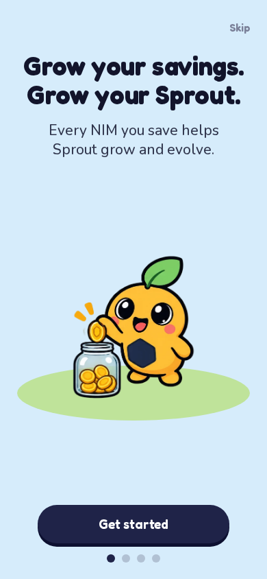
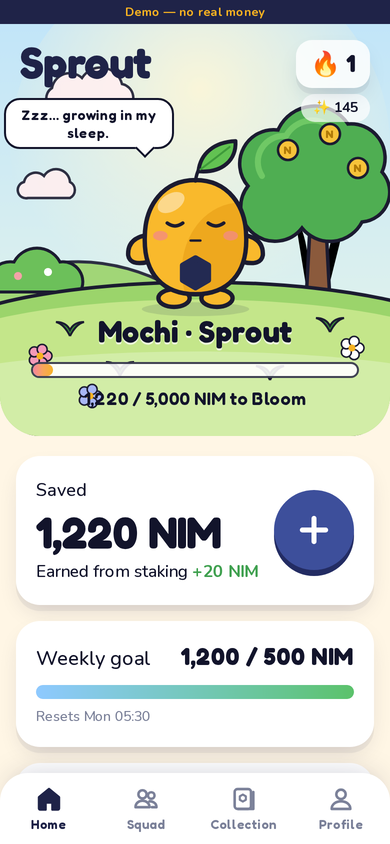
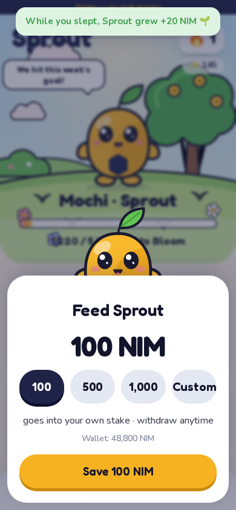
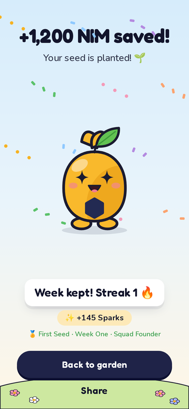
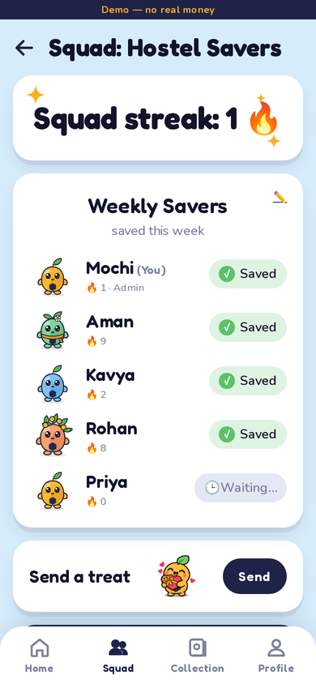
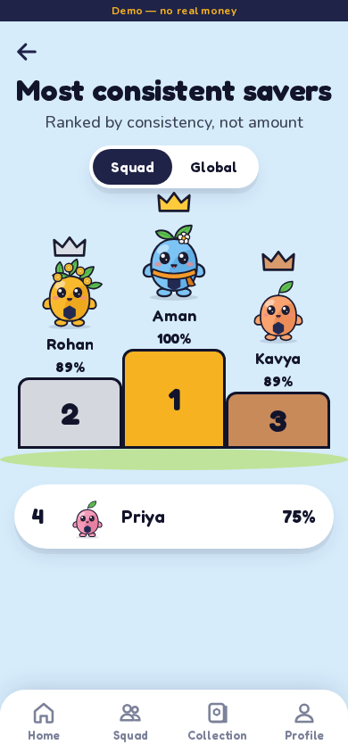
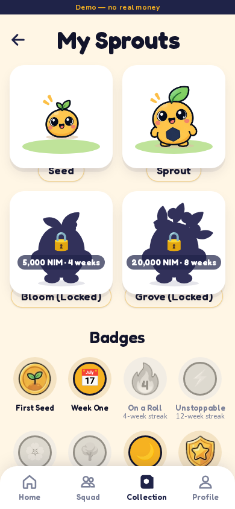
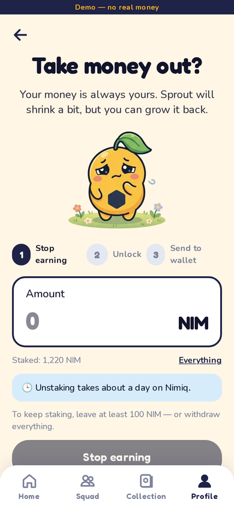

# 🌱 Sprout — save NIM, grow a pet

**Sprout is a Nimiq Pay Mini App that turns saving into a weekly habit.** Your pet, Sprout, only grows
when you save. Every save is a staking transaction from your own wallet into **your own Nimiq stake**, so
your NIM never leaves your address, earns rewards while you sleep, and Sprout grows with it.

Keep a weekly streak, evolve Sprout from **Seed → Sprout → Bloom → Grove**, and save with friends in
**Squads**, where everyone sees who kept their week and can send each other NIM treats.

> Competition: Nimiq Mini Apps Competition · category **Save** · MIT licensed.

<p align="center">
  
  
  
  
</p>
<p align="center">
  
  
  
  
</p>

## Live

| | |
|---|---|
| **Mainnet** (real NIM) | https://sprout-three-neon.vercel.app — Nimiq Pay → Mini Apps → Custom URL |
| **Testnet** (free test NIM) | https://sprout-testnet.vercel.app — switch Nimiq Pay to testnet first |
| **Demo** (any browser) | https://sprout-three-neon.vercel.app/demo |
| **Proof of real saves** | https://sprout-three-neon.vercel.app/proof |

Deployment details: `docs/DEPLOY.md` · recording guide: `docs/VIDEO.md`.

## Try it

- **Any browser:** open `/demo`. It runs the full app with a mock wallet and a fake chain, clearly labeled
  *Demo — no real money*. Profile → Demo tools has **Fast-forward 1 week**, **Receive a treat** and
  **Simulate rewards**, so you can see streaks, evolutions, treats and the 3-step withdraw in minutes.
- **Nimiq Pay:** Mini Apps → Custom URL → your deployment URL, or deep link
  `https://nimpay.app/miniapps/open/<your-domain>`. Opening a URL that isn't in the Mini App list shows a
  warning first; that is expected.
- **Proof of real usage:** `/proof` lists every verified real save with an explorer link.

## Features

| | |
|---|---|
| Sign-in | `sign()` a single-use ASCII challenge → server verifies the Ed25519 Nimiq signed-message → derives the address → 30-day httpOnly session |
| Plant & feed | First save creates your staker (`sendNewStakerTransaction`, ≥ 100 NIM, pool picker); later saves use `sendStakeTransaction` |
| Verified saves | A tx hash is never success: the server confirms *executed, ≥ 2 confirmations, sender is yours, recipient is the staking contract, value matches, stake increased* |
| Pet | Animated SVG rig: 4 stages × 7 moods (celebrating, love, sad, hungry, sleepy, happy, content), blink, breathe, leaf sway, tap giggle, long-press talk, grows up to +15% inside a stage |
| Weekly goal + streak | ISO weeks in UTC; goal changes apply next week; streak never drops before the week ends |
| Grew overnight | Proven staking rewards = stake + withdrawn − deposited. Unknown inputs show "Not known yet", never an estimate |
| Squads | 2–8 members, invite deep link + code + QR, squad streak = weeks where everyone kept their goal |
| Treats | `sendBasicTransactionWithData` with memo `sprout:t:<squadId>`, verified on chain; recipient can **Plant it** or **Say thanks** |
| Leaderboard | Ranked by consistency (kept ÷ eligible weeks), never by amount |
| Sparks & shop | Deterministic awards (no randomness), fixed-price cosmetics with live preview |
| Withdraw | Honest 3 steps from chain state: stop earning → cooldown countdown → unlock → send to wallet, with the 100 NIM rule explained |
| Share cards | Server-rendered 1080×1920 PNG + Web Share API |
| i18n | English, Hindi, Spanish; follows `nimiqPay.language`, overridable |

### Error handling (docs/03 §1)

| Wallet result | What the user sees | Retry |
|---|---|---|
| `PERMISSION_DENIED` | "No problem — nothing was sent." | yes |
| `UNKNOWN_REQUEST` | "Please update Nimiq Pay" | no |
| `INVALID_*` | the reason + "Check the amount" | after a change |
| `NETWORK_ERROR`, `TRANSACTION_OUTCOME_UNKNOWN`, `DUPLICATE_PAYMENT` | **Checking…** lock; the server searches recent staking txs; survives an app restart | **no**, until resolved |
| not inside Nimiq Pay | "Open Sprout in Nimiq Pay" + deep link + demo | — |
| wrong network | "Sprout runs on mainnet…" | — |

Staking invariants (100 NIM minimum, 0-or-≥100 remainder, released-only retire, whole-balance remove) are
checked **before** any wallet dialog opens.

## Architecture

```
Nimiq Pay WebView ── Next.js 16 client (React 19, Tailwind 4, Motion)
   │ @nimiq/mini-app-sdk via src/lib/nimiq/wallet.ts (single error-handling layer)
   ├─ /api/auth/*        challenge → signature verify → JWT cookie, address linking
   ├─ /api/saves/*       register hash → verify on chain → recompute (one DB transaction)
   ├─ /api/stake, /api/validators, /api/withdrawals/*
   ├─ /api/squads/*, /api/treats/*, /api/leaderboard, /api/shop
   ├─ /api/share/:kind/:userId (next/og), /api/proof, /api/health
   └─ /api/demo/* (demo sessions only)
          │
          ├─ Postgres (Neon) via Drizzle — or embedded PGlite when DATABASE_URL is empty
          └─ ChainReader: RpcChain (Nimiq JSON-RPC, allowlisted, fallback URL) | DemoChain (fake ledger)
```

- **Money is `bigint` Luna everywhere**; API JSON carries Luna as strings; conversion to `number` happens only
  at the SDK boundary.
- **Sprout never holds funds.** There is no pool wallet and no server key.
- **Game rules are pure functions with `now` injected** (`src/lib/game/*`), so demo fast-forward is a clock offset.
- Demo users live in a separate namespace and can only ever be verified against the demo chain.

See `docs/` for the full build kit and `DECISIONS.md` for every judgement call.

## Run locally

```bash
npm install
cp .env.example .env.local      # optional: works with zero config (PGlite + demo)
npm run dev                     # http://localhost:3000  → /demo
```

Open it on your phone in Nimiq Pay: `npm run dev -- --hostname 0.0.0.0`, then Mini Apps → Custom URL →
`http://<laptop-LAN-IP>:3000` (or a `cloudflared` tunnel for HTTPS). `/dev/wallet` (dev only) compares
`listAccounts()` with the address derived from `sign()` — run it once on a real phone.

### Environment

| Variable | Purpose |
|---|---|
| `AUTH_SECRET` | JWT key, required in production (`openssl rand -base64 32`) |
| `DATABASE_URL` | Postgres (Neon). Empty → embedded PGlite in `.data/` |
| `NIMIQ_RPC_URL`, `NIMIQ_RPC_URL_FALLBACK`, `NIMIQ_RPC_AUTH` | Server-only JSON-RPC for verification |
| `NIMIQ_STAKING_CONTRACT` | Staking contract address (confirm with a real tx) |
| `VALIDATORS_API_URL` | Nimiq Validators API |
| `NEXT_PUBLIC_NIMIQ_NETWORK` | `mainnet` or `testnet` (network guard) |
| `NEXT_PUBLIC_EXPLORER_TX_URL` | Explorer link template, `{hash}` placeholder |
| `DEMO_ENABLED` | `false` disables `/demo` |

### Deploy (Vercel + Neon)

1. Create a Neon database and set `DATABASE_URL`; run `npm run db:migrate`.
2. Set the env vars above in Vercel and deploy. Smoke test `/api/health`, `/demo`, then open in Nimiq Pay.

## Tests

```bash
npm test            # 77 unit + integration tests (game engine, Luna, signatures, addresses, invariants, wallet errors, verification flow on PGlite)
npm run test:e2e    # Playwright demo flows at 360px, 390px and 1280px
npm run lint && npm run typecheck && npm run build
```

CI runs all of the above on every push (`.github/workflows/ci.yml`).

### What is and isn't verified yet

Verified here: everything in demo mode end to end, all unit/integration tests, production build.
Verified against the live network: mainnet and testnet RPC responses (transactions, stakers, not-found errors),
the staking contract address, the validators API, and the address/signature code against the official
`@nimiq/core` library. Both deployments pass the Playwright demo flows.
**Not yet verified:** signing and paying inside Nimiq Pay on a phone — run the checklist in `TESTLOG.md`.

## Project layout

```
src/app/(app)/        Home, Squad, Collection, Shop, Profile, Streak, Leaderboard, Withdraw
src/app/api/          route handlers (see Architecture)
src/components/       pet rig + garden scenes, sheets, celebrations, UI kit
src/lib/nimiq/        wallet, mockWallet, chain, signature, address, invariants, luna, validators
src/lib/game/         config, growth, mood, streak, sparks, badges, cosmetics, leaderboard (pure)
src/lib/server/       verification, recompute, account snapshot, demo chain, squads
art-source/           original art sheets, mockups and the extraction script
docs/                 product spec and build kit
```

## License

MIT — see `LICENSE`. Credits in `CREDITS.md`.
